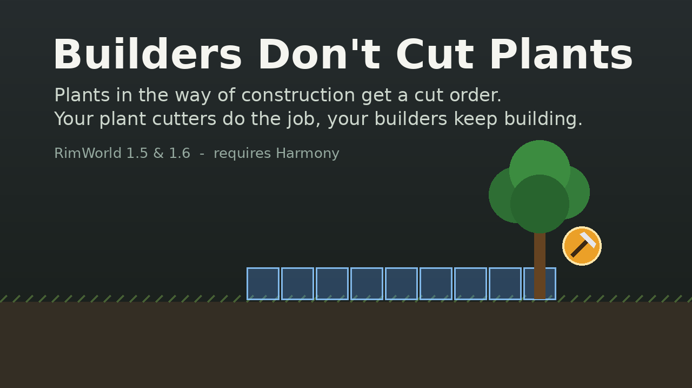

# Builders Don't Cut Plants

A RimWorld mod (1.5 and 1.6) that stops builders from cutting down trees and other plants that are in the way of construction. The plant gets a normal **cut order** instead, so the pawns you assigned to **Plant cutting** do it, with their skill, speed and harvest yield, while your builders keep building.



## What it does

- **Blueprints, frames, reinstalls and roofs.** Whenever vanilla would make a builder cut a plant before building something (or before building a roof), the plant is marked for cutting instead and the builder moves on to other work.
- **Marks plants right away.** Plants are marked as soon as you place a blueprint or paint a build-roof area (including auto-roof), not only when a builder reaches them.
- **Cleans up.** Cancel a blueprint or remove a build-roof area, and the cut orders this mod placed for it are removed again. A harvest order the mod had to replace is restored.
- **Protects special plants.** The anima tree, Gauranlen tree and other plants the game warns about are never marked automatically. You get a message and can mark them yourself. Plants with "prevent cutting" turned on are respected.
- **Explains itself.** Right-click a blocked blueprint with a builder to see what it is waiting for.

## Settings

Options → Mod settings → Builders Don't Cut Plants

| Setting | Default | |
|---|---|---|
| Mark plants as soon as a blueprint or roof area is placed | on | If off, plants are marked when a builder first tries to work there. |
| Also for plants that block building roofs | on | |
| Only trees | off | Builders keep clearing bushes, crops, cacti, ... themselves. |
| Never mark special plants automatically | on | |
| Builders cut plants themselves if nobody is assigned to plant cutting | on | Stops construction from waiting forever. Counts colonists, slaves and mechs on the map with Plant cutting enabled. |
| Builders with a high Plants skill cut plants themselves | off | With a minimum Plants skill slider. |

## Installation

1. Install [Harmony](https://steamcommunity.com/sharedfiles/filedetails/?id=2009463077) ([GitHub](https://github.com/pardeike/HarmonyRimWorld/releases/latest)).
2. Download this repository (Code → Download ZIP) and extract it into your `RimWorld/Mods` folder, so that you have `Mods/<folder>/About/About.xml`.
3. Enable **Harmony** and then **Builders Don't Cut Plants** in the mod list. Load order: anywhere after Harmony.

It is safe to add to or remove from an existing save.

## Compatibility

- Only Harmony postfixes (plus one cleanup prefix that never skips the original method). No transpilers, no new defs, no XML patches, nothing saved in your save game.
- Only uses the vanilla cut order, so everything that works with plant cutting (work tabs, priorities, other plant mods) works with it.
- Multiplayer: plants are only marked from the normal game simulation, never from the right-click menu. All players need the same mod settings.
- Construction mods that change *what* blocks construction (for example Replace Stuff) keep working: this mod only changes *who* cuts a blocking plant.
- Can be used together with *Cut plants before building (Continued)*. Both mark plants; this mod skips plants that already have an order.

## How it works

Vanilla hands a builder its "clear the site" job in `GenConstruct.HandleBlockingThingJob` (blueprints and frames) and `RoofUtility.HandleBlockingThingJob` (roofs). This mod postfixes those, and the matching "is there a job?" checks (`HasJobOnThing` overrides of the construction work givers in 1.6, `RoofUtility.CanHandleBlockingThing`), so they stay in sync. Otherwise the work scan would log an error and the builder would idle. When the job would be cutting a plant, the mod gives that plant a vanilla cut order and returns "no job" with a reason. `Blueprint.SpawnSetup`, `Blueprint.DeSpawn` and `Area.Set` (build-roof area) handle marking on placement and the cleanup.

## Building from source

Requires the .NET SDK (6 or newer). The game's reference assemblies come from NuGet ([Krafs.Rimworld.Ref](https://www.nuget.org/packages/Krafs.Rimworld.Ref)), so the game doesn't need to be installed.

```sh
cd Source
./build.sh            # builds 1.5/Assemblies and 1.6/Assemblies
```

## Similar mods

[Cut plants before building (Continued)](https://steamcommunity.com/sharedfiles/filedetails/?id=3286376165) marks blocking plants when you place a blueprint, and its idea of leaving special trees alone inspired this mod. It doesn't stop a builder from cutting a plant itself, though. Its option to let only pawns with Plant cutting enabled cut blocking plants works by making every other pawn unwilling to cut plants. Vanilla checks the same thing for harvesting and sowing, so it also affects growers.

## License

MIT, see [LICENSE](LICENSE).
